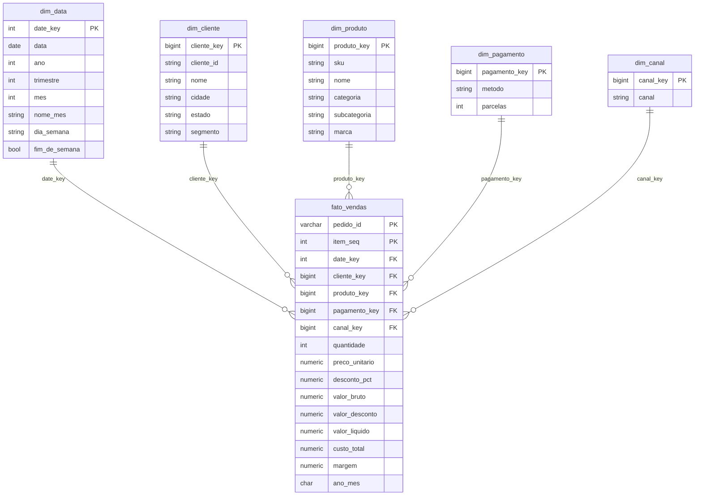

# Modelo dimensional

**Processo de negócio:** vendas de e-commerce.
**Grão da fato:** uma linha por *item de pedido* — chave `(pedido_id, item_seq)`.
**Regra de negócio:** pedidos `CANCELADO` ficam fora da fato (continuam na camada silver).

## Medidas

| Medida | Tipo | Definição |
|---|---|---|
| `valor_bruto` | aditiva | `quantidade × preco_unitario` |
| `valor_desconto` | aditiva | `valor_bruto × desconto_pct` |
| `valor_liquido` | aditiva | `valor_bruto − valor_desconto` |
| `custo_total` | aditiva | `quantidade × custo do produto` |
| `margem` | aditiva | `valor_liquido − custo_total` |
| `preco_unitario`, `desconto_pct` | não aditivas | atributos do item; não se somam |

Margem **percentual** não é armazenada: razões não são aditivas. Calcula-se na consulta como `SUM(margem) / SUM(valor_liquido)`.

## Decisões de projeto

**Chaves substitutas por hash determinístico (`xxhash64` da chave natural).**
`row_number()` ou `monotonically_increasing_id()` gerariam chaves diferentes a cada execução e exigiriam consultar a dimensão já existente para manter a fato coerente. Com hash, dimensão e fato calculam a mesma chave de forma independente e em paralelo, e reprocessar é idempotente. O custo: colisão teoricamente possível (probabilidade desprezível em 64 bits para este volume); `validate_star` detecta chaves duplicadas.

**`dim_cliente` como SCD tipo 1.** Mantém o atributo mais recente *não nulo*, de modo que um pedido novo sem cidade não apaga uma cidade já conhecida. Se o negócio precisasse do histórico (por exemplo, "em que cidade o cliente morava na época da compra"), o passo seguinte seria SCD tipo 2 com `valido_de`/`valido_ate`.

**`dim_data` sem lacunas.** Gerada com `sequence()` do primeiro ao último dia observado, não a partir das datas com venda. Dias sem venda precisam existir para que relatórios por período não "pulem" dias.

**`dim_pagamento` combina método e parcelas.** Parcelamento é atributo de baixa cardinalidade que se analisa junto com o método; separar criaria uma dimensão a mais sem ganho.

**Partição da fato por `ano_mes`.** Consultas por período leem só as pastas necessárias (*partition pruning*). `ano_mes` tem 24 valores, cardinalidade segura. Particionar por dia criaria centenas de diretórios com arquivos minúsculos (*small files problem*).

## Camada de qualidade

Registros que não podem entrar no modelo vão para quarentena (`data/rejected`, particionado por `motivo`) em vez de serem descartados em silêncio:

| Motivo | Etapa | Exemplo |
|---|---|---|
| `json_malformado` | raw | linha truncada |
| `campo_obrigatorio_ausente` | pedido | sem `customer.id` |
| `pedido_duplicado` | pedido | reenvio do mesmo `order_id` |
| `item_invalido` | item | `qty <= 0`, preço inválido, pedido sem itens |
| `sku_fora_do_catalogo` | item | SKU inexistente em `products.csv` |

Depois da gold, `validate_star` verifica: nenhuma FK órfã na fato, grão único e chaves únicas em cada dimensão. A pipeline **falha** se qualquer violação for encontrada, e também se a contagem da fato não reconciliar com os itens não cancelados da silver.
